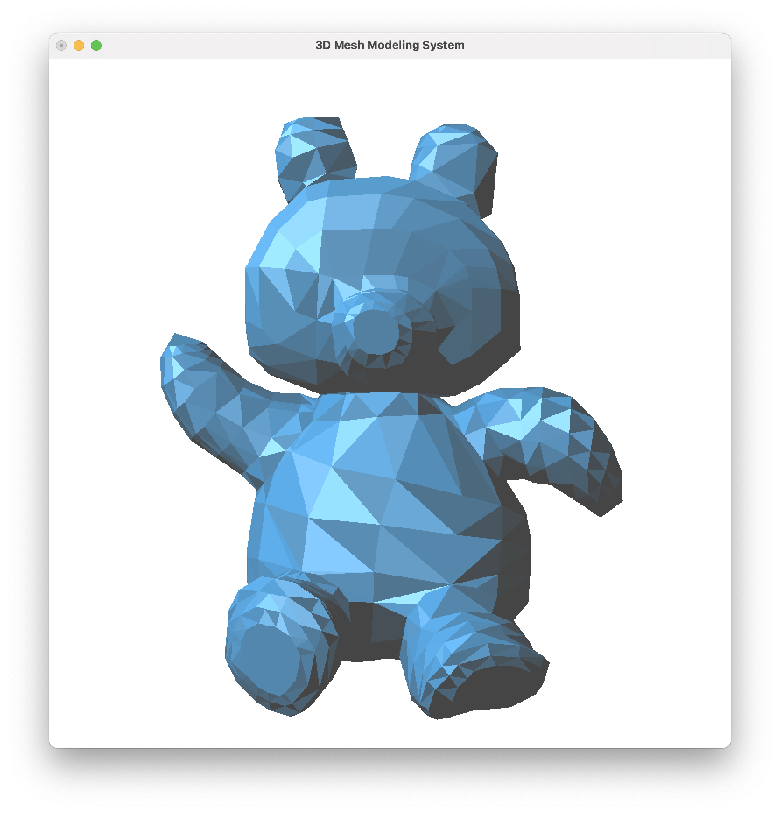
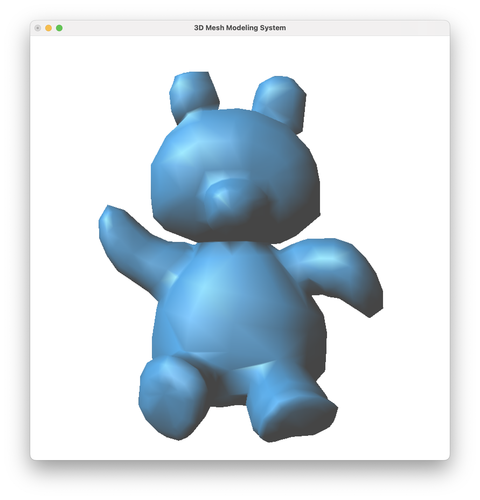
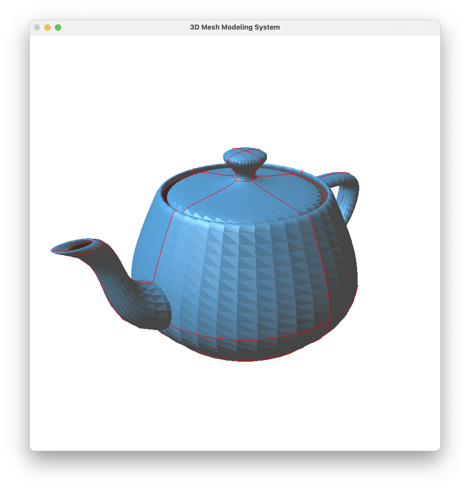
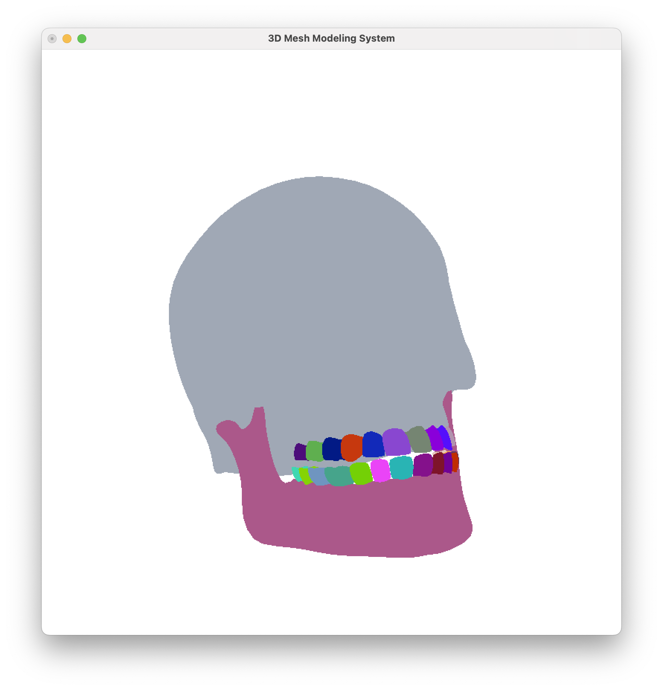

# 3D Mesh Modeling System

A C++/OpenGL tool that loads Wavefront OBJ triangle meshes, builds an oriented-triangle adjacency structure, and visualizes shading, boundary edges and connected components interactively.

| Flat shading | Smooth shading (`S`) |
| :---: | :---: |
|  |  |
| **Boundary edges (`B`)** | **Connected components (`H`)** |
|  |  |

## Features

- **Oriented-triangle mesh structure.** Each face has six versions (three edges in two directions), navigated with constant-time `enext`, `sym`, `org` and `dest` operators.
- **Face adjacency (`fnext`).** At load time every edge is linked to the triangle on its other side, using a vertex-to-triangle index instead of a scan over all triangles.
- **Flat and smooth shading.** Per-face normals from cross products, averaged into per-vertex normals for Gouraud shading.
- **Mesh-quality statistics.** The minimum and maximum angle of every triangle, binned into 18 ten-degree histograms, with degenerate (zero-length-edge) triangles skipped.
- **Connected components.** Counted with an iterative, stack-based depth-first search over the adjacency table.
- **Boundary edges.** Edges that border exactly one triangle are drawn as a red overlay, exposing holes and open surfaces.
- **Component colouring.** Each connected component is drawn in its own colour, with a reseedable palette.
- **OBJ export.** Writes the current mesh back to a new OBJ file.
- **Batched rendering.** The whole mesh is drawn with vertex arrays and a single indexed `glDrawElements` call per frame.

## Performance

Measured on a Mac, Release build, median of 5 runs. Times cover loading and analysis (parsing, normals, angle statistics, adjacency and components), not rendering.

| Mesh | Size | Load time |
| --- | --- | --- |
| `sample-models/destroyer.obj` (Git LFS) | 107.8 MB, 2,379,792 vertices, 1,574,657 triangles | about 1.75 s (1,749 ms) |
| `sample-models/trex.obj`, before the `fnext` change | 7,753 vertices, 15,169 triangles | 6,334 ms |
| `sample-models/trex.obj`, after the `fnext` change | 7,753 vertices, 15,169 triangles | 32 ms |

Replacing the full triangle scan in `fnext` with a vertex-to-triangle lookup cut adjacency construction from O(n²) to near-linear time, making `trex.obj` load nearly 200× faster. Capacity is 2.5M vertices and 1.7M triangles (`MAXV` and `MAXT` in `Source/mesh.h`).

## Controls

| Input | Action |
| --- | --- |
| `S` | Toggle smooth shading |
| `H` | Toggle connected-component colouring |
| `C` | Change component colours |
| `B` | Toggle boundary edges |
| `W` | Wireframe |
| `P` | Filled polygons |
| `V` | Vertices only |
| `O` | Write the mesh to an OBJ file (filename typed in the console) |
| `Q` | Quit |
| Left drag | Rotate |
| Right drag | Zoom |

## Build and run

Requires macOS with Xcode (OpenGL and GLUT are system frameworks).

1. Open `MeshModeler.xcodeproj` in Xcode.
2. Press Cmd + R to build and run.
3. In the console, enter the path of an OBJ file, for example `sample-models/teapot.obj`. The scheme runs from the project folder, so paths relative to the repository root work.

The largest sample model, `destroyer.obj`, is stored with [Git LFS](https://git-lfs.com). Install Git LFS, then run `git lfs pull` after cloning. Without it, the file is a small text pointer and the program reports 0 vertices.

The console prints the vertex and triangle counts, the angle statistics, the number of connected components and the load time, then opens the viewer window.

## Project layout

```
Source/
  main.cpp      GLUT window, camera, lighting and input handling
  mesh.h        Mesh class and oriented-triangle helpers
  mesh.cpp      OBJ reading and writing, normals, statistics, adjacency,
                components, boundary edges and drawing
sample-models/  Example OBJ meshes, from 6 to 1,574,657 triangles (the largest via Git LFS)
docs/images/    Screenshots
MeshModeler.xcodeproj
```

## Built on

This project extends a minimal OpenGL/GLUT OBJ viewer. The base code provided the GLUT window and camera setup, lighting, mouse rotate and zoom, the basic OBJ line reader, and the oriented-triangle bit-packing helpers (`makeOrTri`, `idx`, `ver`). The mesh structure operators, adjacency, normals, statistics, components, boundary and component visualization, OBJ export, large-file support and rendering changes listed above are my own work.
